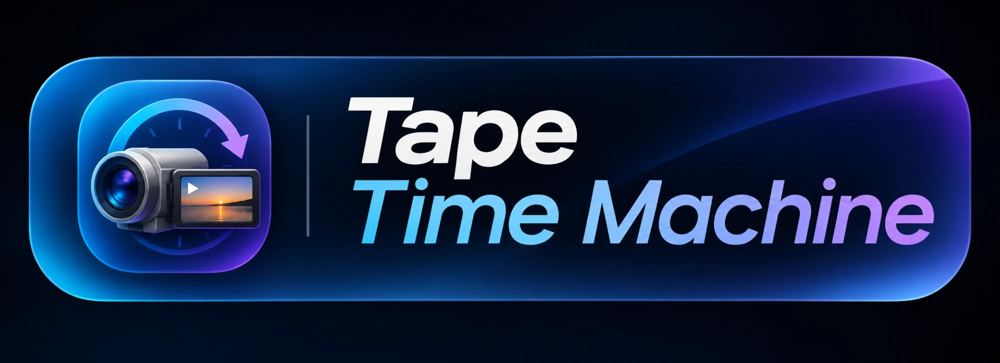
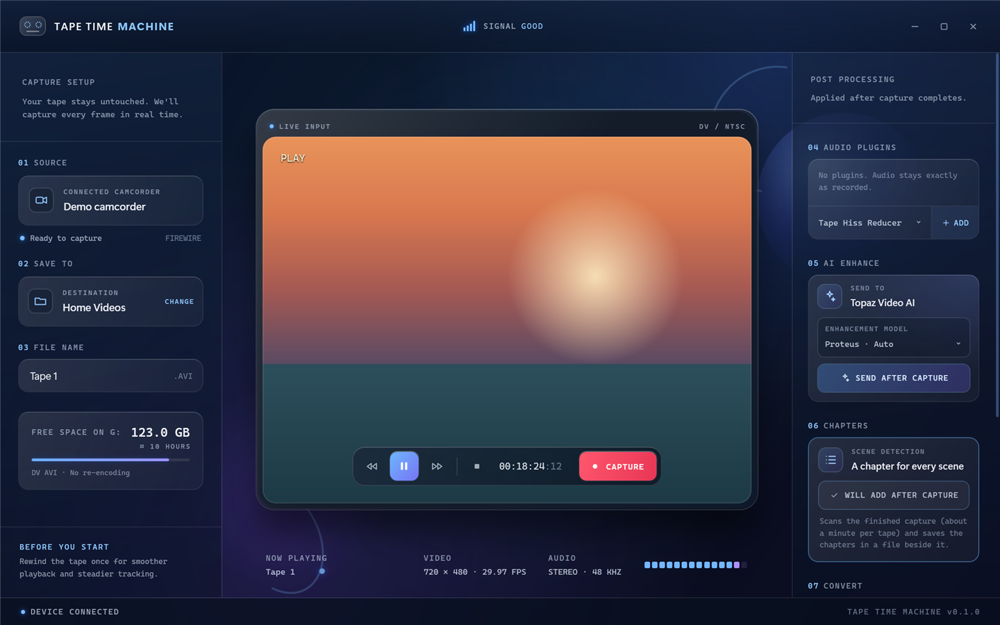

<h1 align="center"></h1>


<sub>Shown in demo mode with a generated test picture.</sub>

A Windows app for rescuing Hi8, Video8 and Digital8 tapes. Plug a Digital8 camcorder into the PC over FireWire, press **Capture**, and it records the tape exactly as the camcorder sends it (DV, no re-encoding). It is a modern replacement for WinDV and Scenalyzer Live, aimed at people who just want their family tapes saved.

## What it does

- **Finds the camcorder** and explains in plain language what to do when it can't (no FireWire port, driver problem, camcorder off, or another program using it).
- **Controls the tape:** play, pause, stop, rewind and fast-forward from the app, with keyboard shortcuts (Space, J, K, L, R).
- **Live preview:** decoded from a copy of each DV frame by FFmpeg and deinterlaced. It also shows a real audio level meter.
- **Capture:**
  - One button starts the tape and records it to a type-2 DV AVI, so the video is never re-encoded.
  - It never overwrites a file and stops by itself when the tape stops or the drive is nearly full.
  - It shows elapsed time, file size and dropped frames as it records.
- **After capture (optional):**
  - Scene detection that writes chapters.
  - Audio clean-up with FFmpeg filters, written to a separate file so the original AVI is untouched.
  - Conversion to MP4 or MKV.
  - Hand-off to Topaz Video AI.

## Requirements

- Windows 10 or 11, x64
- A FireWire (IEEE 1394) port and a camcorder that outputs DV over FireWire (Digital8 or MiniDV). Analog-only Hi8 decks are not supported.
- [.NET 10 SDK](https://dotnet.microsoft.com/download) to build
- [FFmpeg](https://ffmpeg.org/) on the PATH, for the preview and all file processing:

```bash
winget install Microsoft.DotNet.SDK.10
```

```bash
winget install Gyan.FFmpeg
```

## Build and run

```bash
dotnet build -c Release
```

```bash
bin\Release\net10.0-windows\TapeTimeMachine.exe
```

Settings and a troubleshooting log live in `%LOCALAPPDATA%\TapeTimeMachine\`.

### Debug-only options

Debug builds accept a few switches for working on the app without a camcorder, or for testing one. None of them are compiled into Release builds.

| Switch | What it does |
|---|---|
| `--demo`, `--demo-capturing`, `--demo-missing` | Shows the interface with a generated test picture; never opens the camcorder |
| `--selftest=<folder>` | Plays, pauses and records a 10-second test capture into `<folder>`, then puts the tape back as it was |
| `--selftest=<folder> --selftest-steps=play:5000,capture:5000` | Runs a custom list of steps instead; every step is written to the log |

## How it works

- **DirectShow**, using the built-in "Microsoft DV Camera and VCR" driver:
  - `IAMExtTransport` controls the tape.
  - A Smart Tee splits the camcorder's stream into a capture branch (DV Splitter → AVI Mux → File Writer) and a preview branch.
- **Preview:** copies each raw DV frame into memory and decodes it with FFmpeg through a pipe. Decoding straight from the driver's buffers showed block errors, because the driver reuses them quickly.
- **UI:** WPF on .NET 10, built from the "Tape Time Machine Capture App" Figma Make design.

## Status

Early and in active development. Capture, preview and tape control have been tested with a Sony Digital8 camcorder. Resuming a partial capture is planned. Some camcorders don't report timecode or a tape counter over FireWire, especially when playing analog Hi8 tapes.

## License

[MIT](LICENSE). Uses [DirectShowLib](https://www.nuget.org/packages/DirectShowLib) (LGPL 2.1) as a NuGet package, and calls FFmpeg as a separate program; neither is bundled in this repository.
